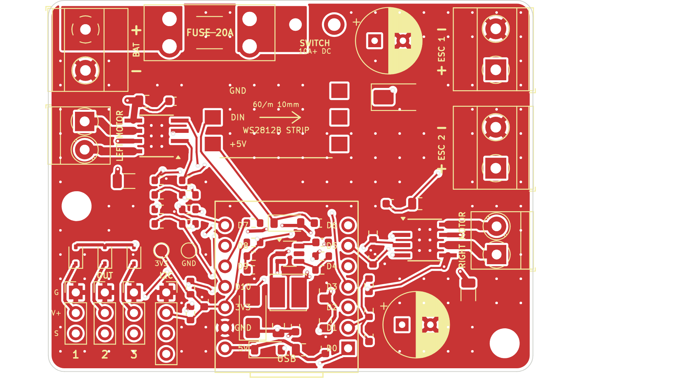
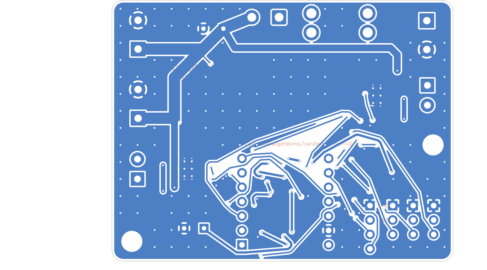

# Cardboard Bot v2 – main board (rev B)

60 × 46 mm, 2-layer, 2 oz copper, for a **2S or 3S LiPo** on a screw terminal. JLCPCB assembles
the SMD parts on the top side; CGW hand-solders the through-hole parts. Nothing goes on the back.

| What | Where |
|---|---|
| Schematic (PDF) | `docs/schematic.pdf` |
| KiCad 7 project | `cardboard-bot.kicad_pro` / `.kicad_sch` / `.kicad_pcb` |
| JLCPCB upload files | `fab/` (gerber zip, BOM, CPL) |
| Hand-solder list | `fab/cardboard-bot-v2-revB-hand-solder.csv` |
| Part-number check list | `docs/BOM_CHECK.md` |

## What's on the board

Parts were picked for JLC stock: Basic or no-fee Preferred parts wherever JLC has one, otherwise a
well-stocked Extended part (stock checked 28 Oct 2026, see `docs/BOM_CHECK.md`). Everything on the
battery side is rated above 3S (12.6 V full).

- **Battery input:** 5.08 mm screw terminal J1 (top-left), then a **20 A mini blade fuse**, then two
  wire pads for an off-board **power switch** (10 A+ DC, 18 AWG). A unidirectional **SMAJ13A**
  clamps spikes at about 21 V; a reversed battery makes it conduct and blows the fuse.
- **ESC power:** two 5.08 mm screw terminals on the right edge (ESC 1, ESC 2), after the fuse
  and switch, with a 470 µF / 25 V bulk capacitor next to them.
- **Drive:** two **DRV8870** H-bridges (6.5–45 V, 3.6 A peak), one per motor, each next to its
  3.5 mm motor terminal: **LEFT MOTOR** on the left edge, **RIGHT MOTOR** on the right edge.
  0.1 Ω sense resistors and VREF = 2.53 V limit each motor to about 2.5 A. The DRV8870 stops
  below about 6.5 V, so on 2S the drive cuts out near empty (the firmware stops it at 3.0 V/cell anyway).
- **5 V:** TPS54202 buck (28 V max in) behind a Schottky diode and a 470 µF / 25 V hold-up
  capacitor, so ESC current spikes can't reset the ESP32. A second Schottky feeds the XIAO, so
  plugging in its USB while the robot is on is safe.
- **Outputs:** three 3-pin headers (GND / V+ / SIG): OUT1 (GPIO10), OUT2 (GPIO20), OUT3 (GPIO21).
  V+ is 5 V through a Schottky per output, so an ESC's BEC can't back-feed the board. The
  firmware default is two weapon ESCs on OUT1 and OUT2. OUT3's pin carries the ESP32 boot
  messages for a moment at power-up, so use it for a servo rather than an ESC.
- **Pull-downs:** 10k on all four motor inputs and all three outputs, so the motors coast and the
  ESCs see "off" while the ESP32 resets and boots (its pins float until the firmware starts).
- **Battery sense:** pack ÷ 6 (100k / 20k) on GPIO3, so 3S full (12.6 V) reads 2.1 V. The
  firmware detects 2S / 3S at power-on.
- **Status LED:** pads for one LED cut from a WS2812B strip (5 V, 60 LED/m, 10 mm), powered
  through a 1N4148W (about 4.2 V) so the 3.3 V data line is read reliably.
- **I2C header** J2 (GND, 3V3, SCL, SDA) with pull-ups, for add-ons.
- **Mounting:** two M3 holes (left middle, bottom right).

### XIAO pin map

| XIAO | GPIO | Use |
|---|---|---|
| D0 | 2 | SDA (I2C header) |
| D1 | 3 | Battery sense (pack ÷ 6) |
| D2 / D3 | 4 / 5 | Left DRV8870 IN1 / IN2 |
| D4 / D5 | 6 / 7 | Right DRV8870 IN1 / IN2 |
| D6 | 21 | OUT3 – also UART TX at boot |
| D7 | 20 | OUT2 |
| D8 | 8 | SCL (I2C header) |
| D9 | 9 | RGB LED data (BOOT button pin) |
| D10 | 10 | OUT1 |

GPIO2, GPIO8 and GPIO9 are strapping pins. They only carry signals that idle high at boot
(I2C pull-ups, and the BOOT button with the LED data line), so the chip always boots normally.
None of them has a pull-down.

## Before ordering – check these

1. **LCSC part numbers and stock.** Go through `docs/BOM_CHECK.md` on jlcpcb.com/parts.
2. **JLC placement preview.** `ROT_FIX` in `gen/fab.py` holds the corrections from rev A's preview.
   The DRV8870 (U3, U4) is new: check its pin-1 dot against the silkscreen triangle and add a
   correction if it's turned. JLC flags U1's footprint name (TSOT-23-6 vs SOT-23-6); the pads match.
3. **Values to sanity-check against the datasheets:** DRV8870 VREF / sense resistor (2.5 A limit),
   TPS54202 output inductor (10 µH) and capacitors (2 × 22 µF).
4. **Assembly:**
   - **LED strip:** cut one LED from the strip on the cut lines. Tin the three J10 pads, lay the
     piece on them with its DIN end on the +5V / DIN / GND pads (arrow pointing away), and heat
     each strip pad from the top. Strips differ: check the +5V / DIN / GND order matches the
     silkscreen first, or wire it with three short wires instead.
   - **Power switch:** mount it in the cardboard and run two 18 AWG wires to the SW1 pads.
   - **Battery:** use 14–16 AWG leads into J1. The 5.08 mm terminals are rated about 16 A; for
     bigger weapons, solder the battery leads instead.

## Regenerating

Everything is generated from `gen/circuit.py` (parts, LCSC numbers, nets).
You need KiCad 7 (`kicad-cli` and its Python module), python3-numpy and python3-pil.

```sh
python3 gen/gen_footprints.py          # lib/cgw.pretty (XIAO socket, LED strip pads, CGW logos)
python3 gen/gen_sch.py                 # schematic + lib/cgw.kicad_sym
kicad-cli sch export pdf -o docs/schematic.pdf cardboard-bot.kicad_sch
PY=/usr/bin/python3.12
$PY gen/gen_pcb.py                     # outline, placement, silkscreen, pre-routed power copper, router keepouts
$PY gen/route.py --stage zones         # GND pours (both layers) + solid power pours
$PY gen/fixroute.py                    # A* grid router for every remaining connection (rips up and retries)
$PY gen/route.py --stage stitch        # GND stitching vias
$PY gen/islands.py                     # ties any leftover GND pour islands
$PY gen/gnd_check.py                   # lists GND copper cut off from the main cluster (DRC won't say where)
(cd gen && $PY tie_pad.py --min 3 REF PAD)   # route a stranded pad to a GND via, if gnd_check finds one
$PY gen/route.py --stage drop-keepouts && $PY gen/route.py --stage fill
$PY gen/silk.py                        # redraw labels only (safe on a routed board)
$PY gen/drc.py                         # DRC summary
python3 gen/fab.py                     # fab/ outputs; BOM and CPL designators are cross-checked
bash gen/render.sh                     # PNG previews
```

`gen_pcb.py` builds the board from scratch, which wipes the routing. A full re-route takes a few
minutes. After small changes it is usually easier to edit `cardboard-bot.kicad_pcb` in KiCad directly.
`gen/patch_prewire.py NET,...` re-applies the fixed copper of individual nets on a routed board.

This board was routed with `gen/fixroute.py`. `gen/route.py` can also run Freerouting if you have
Java and `freerouting.jar` installed (`route.py` with no arguments).

## Preview

| Top | Bottom (mirrored) |
|---|---|
|  |  |
